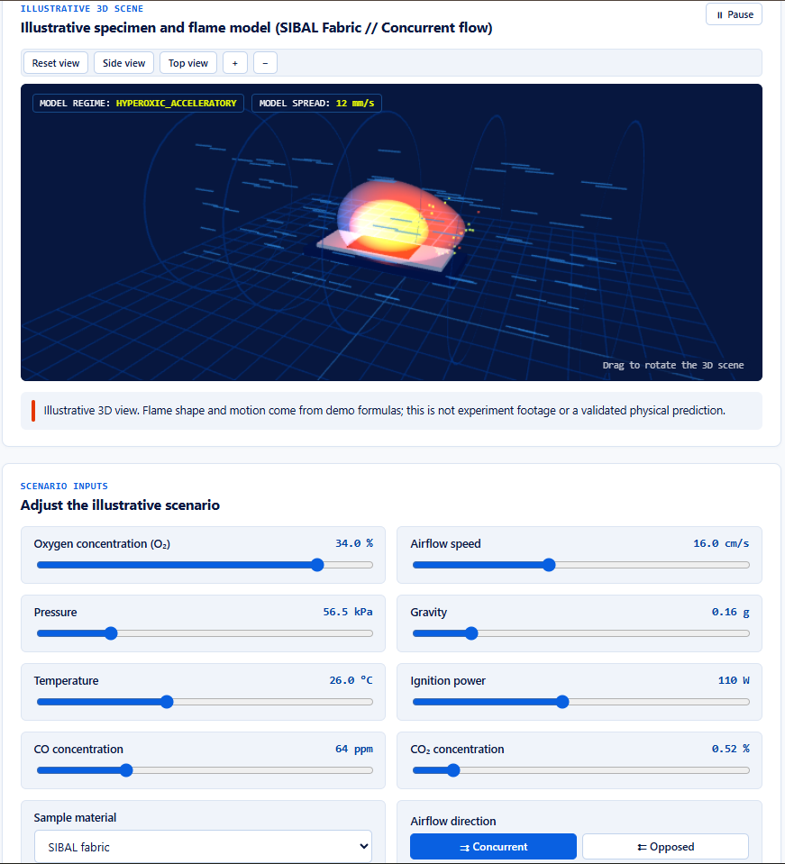
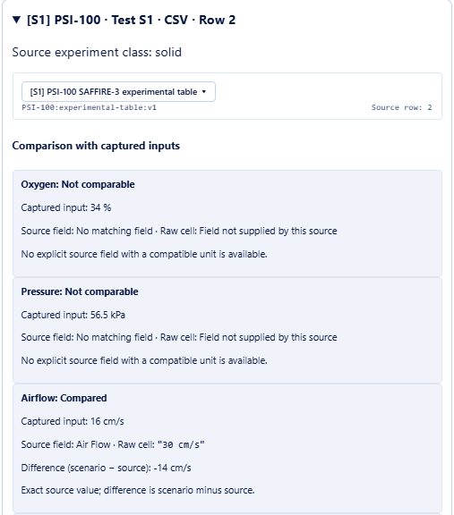
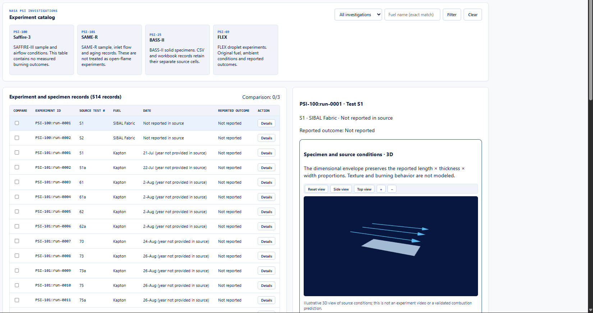
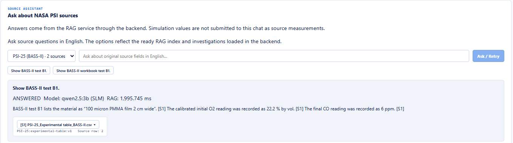
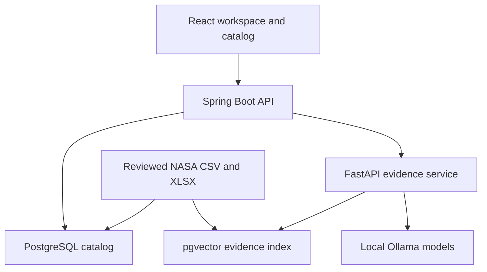

# FLAMESCOPE

### Explore NASA combustion research with evidence you can inspect.

**Team PYROSPHERE · NASA Space Apps Challenge 2026 · Flame in Freefall**

FLAMESCOPE is a working research prototype that brings NASA combustion records into an interactive workspace. Explore a scenario, compare supported conditions with original source fields, and ask a source assistant questions whose answers include inspectable citations.

Our goal is to help a reader move from **“Which experiment is relevant?”** to **“What does this source actually say?”** without losing the context behind a number.

**Current scope:** four investigations, 514 experiment/specimen catalog records, five source files and 643 independently preserved evidence rows.

The animated flame, example curves and 0–100 score are illustrative model outputs. Source comparisons and cited measurements come from a separate evidence path. The prototype does not establish fire probabilities or certify safe operating conditions.

[Start the jury walkthrough](#a-short-route-for-judges) · [Explore the data](#the-nasa-data-behind-the-project) · [Understand the AI](#where-ai-helps) · [Run locally](#running-the-project-locally) · [Repository](https://github.com/Uaekiz/nasa)

## A short route for judges

If you have only a few minutes, follow these four steps in the running application. This README provides the context; the screens provide the evidence.

| Step | Where to go | What to look for |
| --- | --- | --- |
| 1 | **Scenario workspace** | Change the inputs, inspect the illustrative 3D scene, then capture the scenario and image. |
| 2 | **Review the current scenario** | Analyze the captured inputs. Open a citation to inspect the original source field, value, unit and row. |
| 3 | **Source assistant** | Select BASS-II and ask `Show BASS-II test B1.` Open the citation beneath the answer. |
| 4 | **NASA PSI Catalog** | Explore the four investigations, inspect a record and compare available measurements across selected records. |

**The key demonstration:** a displayed comparison or answer can be followed back to its original source cells. A result also shows when a source cannot support the requested comparison.

## The problem we address

NASA's combustion research includes different materials, experimental conditions and kinds of observations. A solid specimen, a burning droplet and a smoke-aging study do not answer the same question. Even within one investigation, CSV and workbook versions can preserve different text or numerical representations.

Finding a record is therefore only part of the task. A researcher or student also needs to know which fields are relevant, which units are compatible and what the source does not report.

FLAMESCOPE brings those questions into one interface. It connects visual exploration to source inspection and explains supported differences without turning a nearby record into proof of equivalent behavior.

## What works today

### 1. Interactive scenario exploration

The workspace exposes material, oxygen concentration, pressure, airflow speed, gravity, temperature, ignition power, CO, CO₂ and relative airflow direction. Presets provide convenient starting points, and the 3D scene supports camera rotation, zoom, reset, alternate views and pause.

Users capture the selected inputs together with a PNG of the 3D view. Subsequent analysis refers to that captured state. Changing the controls marks the previous result as belonging to an older scenario, and late responses cannot overwrite a newer capture.

The captured image remains local to this workflow. The scenario request sends the timestamp and parameters, **not the image**. The image is not analyzed by a vision model.



*The scene is an interactive illustration. Its flame geometry and motion are not measured experiment footage or a validated combustion simulation.*

### 2. Source-backed scenario analysis

After capture, the analysis panel shows the saved inputs, a source-based assessment, review checks, parameter coverage and expandable original source records.

Comparison rules use explicitly mapped fields and compatible units. Each parameter has a visible result: compared, partly comparable, not comparable, missing from the source or requiring a measurement phase.

CO and CO₂ have separate **initial / final / not specified** selectors. A gas reading left unspecified is not silently matched to either stage of a source experiment. Oxygen comparisons use the appropriate calibrated initial O₂ field where available.

**A concrete example from the prototype:**

| Comparison | Captured scenario | Source value | Supported observation |
| --- | ---: | ---: | --- |
| SAFFIRE-III sample S1 airflow | 16 cm/s | 30 cm/s | Scenario airflow is 14 cm/s lower. |
| BASS-II test T25 initial oxygen | 34% | 20.8% | Scenario oxygen is 13.2 percentage points higher. |

These are comparisons of conditions from separate source records. They do not prove that the experiments are equivalent or that fire risk increased or decreased.



*The source card exposes the source identifier, test, file type, row and original field behind a comparison.*

### 3. An experiment and specimen catalog

The catalog provides investigation and fuel/material filtering, pagination, record details, original source access and comparison of up to three selected records.

Numerical comparisons use eligible verified measurements. The interface shows unavailable fields and comparison limitations, rather than treating every selected record as fully comparable.

A separate 3D specimen view represents reported geometry where suitable exact dimensions exist. Missing dimensions produce an explicitly unscaled or limited representation. This source-driven view is separate from the animated scenario flame.



### 4. A source assistant with inspectable answers

Users ask questions in English about the available source records. Investigation choices and suggested questions reflect the intersection of the backend catalog and the RAG service's validated ready scope.

Examples include:

- `Show BASS-II test B1.`
- `Show BASS-II workbook test B1.`
- `Show SAFFIRE-III sample S1.`
- `Show SAME-R test 51a.`
- `Show both records for identifier 193F001.`

The demonstrated BASS-II B1 answer reports a PMMA film specimen, an initial oxygen reading of 22.2% by volume and a final CO reading of 6 ppm, with source citations. Those are source-record facts, not values inferred from the 3D scene.



*This is a captured prototype response. Model availability and response time depend on the local environment; the image is not a live service-status indicator.*

## The NASA data behind the project

| Investigation | NASA PSI ID | Catalog records | Evidence rows | Included evidence |
| --- | --- | ---: | ---: | --- |
| FLEX | PSI-69 | 274 | 274 | Droplet test records from CSV. |
| BASS-II | PSI-25 | 129 | 258 | Solid-specimen CSV records and separately preserved workbook rows. |
| SAFFIRE-III | PSI-100 | 2 | 2 | Sample dimensions, material and airflow conditions. |
| SAME-R | PSI-101 | 109 | 109 | Smoke/aging records and inlet conditions. |
| **Total** | **4 investigations** | **514** | **643** | **5 source files** |

**Why 514 and 643?** BASS-II's 129 workbook rows provide an additional source version for the same cataloged tests. They remain separately citable evidence and do not create another 129 experiments. The catalog total also includes specimen/condition records; it is not a count of 514 interchangeable combustion trials.

### Original NASA investigation pages

- [FLEX / PSI-69](https://psi.nasa.gov/physci/repo/data/investigations/PSI-69) — DOI: `10.60555/mbq8-0451`.
- [BASS-II / PSI-25](https://psi.nasa.gov/physci/repo/data/investigations/PSI-25) — DOI: `10.60555/4qc4-de67`.
- [SAFFIRE-III / PSI-100](https://psi.nasa.gov/physci/repo/data/investigations/PSI-100) — DOI: `10.60555/040q-4h36`.
- [SAME-R / PSI-101](https://psi.nasa.gov/physci/repo/data/investigations/PSI-101) — DOI: `10.60555/2np7-jv14`.

The reviewed source catalog records filenames, source identifiers, encoding, provenance URLs and SHA-256 hashes. See [`rag-service/source_catalog.json`](rag-service/source_catalog.json), [`data/manifest.json`](data/manifest.json) and the [multi-source integration report](docs/multi-source-integration.md).

### What preservation means here

- Original headers and cells remain available alongside normalized views.
- CSV and XLSX alternatives keep their own citations, worksheet/row details and raw differences.
- Blank cells, qualifiers and incomplete dates remain explicit. A date without a year does not receive an invented year.
- Documented unit conversions preserve the original value and conversion method. Instrument display settings are not silently converted into physical airflow speeds.
- Source test identifiers remain distinct from application experiment identifiers. Repeated source identifiers can refer to multiple retained records.

## Where AI helps

### RAG for source questions

RAG means **Retrieval-Augmented Generation**: the application retrieves relevant source records before asking the language model to produce an answer. The model receives source context instead of being asked to recall an experiment from memory.

The current local configuration uses:

| Component | Role |
| --- | --- |
| `qwen3-embedding:0.6b` | Embeddings for semantic retrieval. |
| PostgreSQL + pgvector | Evidence storage and vector similarity search. |
| `qwen2.5:3b` through Ollama | Constrained source-answer generation and optional scenario review-check ordering. |
| Evidence and answer checks | Validation of cited fields and values against the original source cells. |

Exact test/identifier questions can use deterministic lookup. Semantic retrieval helps find candidate records within the allowed scope. Similarity is a retrieval ranking, not scientific confidence.

Generated fields and citations are checked against original cells before the application renders the answer. Invalid model output can be rejected and replaced by an explicitly labeled direct-source response. Connectivity and timeout errors remain visible errors; the application does not present them as a successful model answer.

Broad counts, averages or extrema are not calculated from a handful of semantic neighbors. Requests requiring structured analysis remain at the backend analysis boundary.

### A different role in scenario analysis

The scenario path computes field comparisons and observations deterministically. Its optional model orders a supplied set of review checks; it does not write the measured values or calculate the differences.

If that ordering model fails while the evidence service remains available, source comparisons and a default check order can still be returned with the failure disclosed. This does not mean every AI feature works when Ollama or the RAG service is offline.

### AI-assisted development disclosure

We used **ChatGPT and Codex** to support implementation, debugging, documentation and presentation preparation. This includes code and text assistance during development. The product's runtime AI path is the local Ollama/RAG integration described above.

NASA source measurements are preserved as source evidence; generated interface text and illustrative visuals do not become new experimental observations. The project artwork and animated scene are separate from NASA experiment imagery.

## Architecture



The diagram shows logical data flow. Source ingestion and indexing are explicit preparation steps, not work repeated for every browser request.

| Layer | Implementation | Responsibility |
| --- | --- | --- |
| Interface | React, Vite, Three.js, ECharts | Scenario controls, 3D views, charts, capture, catalog and citations. |
| Application API | Java 21, Spring Boot, JPA, Flyway | Catalog access, structured record comparisons, validation and RAG proxying. |
| Evidence service | Python, FastAPI, Pydantic | Retrieval, source checks, constrained answers and scenario evidence. |
| Core storage | PostgreSQL | Investigation, experiment/specimen and original source-row records. |
| Retrieval storage | PostgreSQL with pgvector | Validated evidence snapshots, embeddings and index metadata. |
| Local inference | Ollama | Separate embedding and answer models. |

The frontend calls the backend; the backend calls the evidence service. The Vite development proxy forwards `/api` and `/files` to the backend. Normalized UI numbers use `en-US`; original source cells remain verbatim.

## Running the project locally

The following commands target **Windows PowerShell**, matching the documented development environment. They are run from the repository root unless another directory is shown.

### Prerequisites

- Git, Node.js/npm and Java 21 with Maven or the included Maven wrapper.
- A compatible Python environment; the team's documented RAG environment used Python 3.14.
- Docker for the compose-managed core database.
- A provisioned PostgreSQL instance with pgvector for the dedicated RAG database.
- Ollama and the configured models. Model downloads and dependency installation require network access; local inference does not require a cloud model API key.
- The source files referenced by the reviewed manifests. A code checkout without those files or a prepared index is not a ready-to-run evidence service.

### 1. Get the code and install dependencies

```powershell
git clone https://github.com/Uaekiz/nasa.git
cd nasa
git switch feat/rag-service

npm.cmd --prefix frontend ci
python -m venv rag-service/.venv
.\rag-service\.venv\Scripts\python.exe -m pip install -r rag-service/requirements.txt -r data/etl/requirements.txt
```

The commands select `feat/rag-service`, the branch used for the demonstrated multi-source scenario workflow. If that work has since been merged, use the corresponding current release or branch.

### 2. Initialize the core database and backend

```powershell
docker compose up -d db
cd backend
.\mvnw.cmd spring-boot:run
```

The compose file starts **the core database only**, on host port `5433`. Spring Boot runs Flyway migrations for its `core` schema. It does not provision the separate RAG database.

If the Windows wrapper cannot locate Maven, run `mvn spring-boot:run` with a working installed Maven from `backend/`.

In another terminal at the repository root, validate and import the reviewed sources:

```powershell
.\rag-service\.venv\Scripts\python.exe data/etl/audit_sources.py
.\rag-service\.venv\Scripts\python.exe data/etl/load_experiments.py --all-verified --dry-run
.\rag-service\.venv\Scripts\python.exe data/etl/load_experiments.py --all-verified
.\rag-service\.venv\Scripts\python.exe data/etl/verify_sources.py --check-reimport
```

The importer is designed to preserve experiment identities on unchanged re-imports. Review a source hash or mapping error instead of bypassing it.

### 3. Provision and configure the RAG database

The reference setup uses database `pyrosphere_rag`, application role `pyrosphere_rag_app` and the owned `rag` schema, normally on the separately configured PostgreSQL instance at port `5432`.

Follow the [database provisioning guide](rag-service/docs/local-database-setup.md) before indexing. It covers the required schema marker, application-role permissions and vector extension. Its installation paths are examples from the team's Windows machine; adapt them to your installation. Simply creating an empty database is not sufficient.

Copy the configuration example only if you do not already have a local configuration:

```powershell
Copy-Item rag-service/.env.example rag-service/.env
```

From `rag-service/`, configure and verify the application connection with the interactive helper:

```powershell
cd rag-service
.\.venv\Scripts\python.exe -m app.database_setup configure
.\.venv\Scripts\python.exe -m app.database_setup verify
```

The configuration uses a **psycopg PostgreSQL URI**, not a JDBC URL. Keep credentials local. The configuration also selects:

```dotenv
RAG_DB_SCHEMA=rag
RAG_INDEX_NAME=nasa_multi_v1
RAG_CORPUS_MODE=multi
OLLAMA_BASE_URL=http://localhost:11434
OLLAMA_MODEL=qwen2.5:3b
OLLAMA_EMBEDDING_MODEL=qwen3-embedding:0.6b
```

### 4. Prepare models and evidence indexes

If the models are not already installed:

```powershell
ollama pull qwen2.5:3b
ollama pull qwen3-embedding:0.6b
```

Ollama must be running. Index preparation is separate from starting FastAPI. The multi-source indexing tool also checks preservation of the legacy FLEX index, so a fresh installation needs that baseline first.

From `rag-service/`, after provisioning the database:

```powershell
# Prepare the legacy FLEX baseline on a fresh installation.
$env:RAG_DB_SCHEMA='rag'
$env:RAG_INDEX_NAME='legacy'
$env:RAG_CORPUS_MODE='flex'
.\.venv\Scripts\python.exe app/csv_loader.py
.\.venv\Scripts\python.exe -m app.indexing --batch-size 8

# Stage and build the separate multi-source index.
.\.venv\Scripts\python.exe -m app.stage_sources
.\.venv\Scripts\python.exe -m app.multi_index

# Select the multi-source scope for the API.
$env:RAG_DB_SCHEMA='rag'
$env:RAG_INDEX_NAME='nasa_multi_v1'
$env:RAG_CORPUS_MODE='multi'
```

For an already prepared environment, retain the validated indexes and use the matching configuration. Do not delete databases or indexes to resolve a configuration mismatch. See [retrieval/indexing details](rag-service/docs/pgvector.md) and [multi-source integration](docs/multi-source-integration.md).

### 5. Start the evidence service and frontend

In the configured `rag-service/` terminal:

```powershell
.\.venv\Scripts\python.exe -m uvicorn app.main:app --host 127.0.0.1 --port 8000
```

In another terminal at the repository root:

```powershell
npm.cmd --prefix frontend run dev
```

| Component | Default development address |
| --- | --- |
| Frontend | `http://localhost:5173` |
| Backend health | `http://localhost:8080/api/v1/health` |
| RAG health | `http://localhost:8000/rag/v1/health` |
| RAG ready scope | `http://localhost:8000/rag/v1/capabilities` |
| Backend-proxied ready scope | `http://localhost:8080/api/v1/chat/capabilities` |

Use the frontend address printed by Vite if its default port is occupied. A backend health indicator confirms backend reachability only; it does not prove that the index and both models are ready. The capabilities response should report the validated multi-source scope.

## API orientation

| Route | Purpose |
| --- | --- |
| `GET /api/v1/investigations` | Available investigation catalog. |
| `GET /api/v1/experiments` | Filtered/paginated records. |
| `GET /api/v1/experiments/{experimentId}` | Record details and source context. |
| `GET /api/v1/sources/{sourceId}` | Source metadata. |
| `POST /api/v1/comparisons` | Structured comparison of selected records. |
| `POST /api/v1/scenario-analyses` | Source-backed analysis of captured inputs. |
| `GET /api/v1/chat/capabilities` | Validated ready question scope. |
| `POST /api/v1/chat` | Backend entry point for source questions. |
| `GET /rag/v1/capabilities` | Evidence service's validated ready scope. |
| `POST /rag/v1/answer` | Source-answer path. |
| `POST /rag/v1/scenarios/evidence` | Scenario evidence and optional review-check ordering. |

For request fields, response states and errors, see the [API contract](docs/api-contract-v1.md). Availability of a route does not imply that every investigation or analysis type is supported.

## Verification and reproducibility

The project includes checks for source preservation, unchanged re-imports, numerical comparison rules, citations, rejected model output, request races and frontend behavior. The linked reports record checks performed during development; they are not a claim that every test or live-model check was rerun whenever this README was edited.

```powershell
# Frontend: from the repository root.
npm.cmd --prefix frontend test
npm.cmd --prefix frontend run lint
npm.cmd --prefix frontend run build

# Backend: from backend/, with its configured core database available.
.\mvnw.cmd test

# RAG: from rag-service/.
.\.venv\Scripts\python.exe -m unittest discover -s tests -v

# Explicit live check: needs prepared sources, database, indexes and Ollama.
.\.venv\Scripts\python.exe -m app.multi_checks
```

Some database/provisioning tests are opt-in and need dedicated test configuration. Mocked validation, direct-source fallback and a successful live model call are different checks; the reports distinguish them.

Further evidence:

- [Scenario completion and verification](docs/flamescope-completion.md).
- [Source narratives, dates and 3D specimen behavior](docs/source-narrative-and-3d.md).
- [Multi-source integration and provenance](docs/multi-source-integration.md).
- [Source audit](docs/local-source-audit.json).
- [Record-question coverage](docs/record-question-coverage.md).

## Current scientific and technical boundaries

| Area | Current boundary |
| --- | --- |
| Animated flame, score and charts | Local illustrative formulas. No calibrated fire probability, validated forecast or measured intervention effect. |
| Source-driven 3D view | Representation of available dimensions/conditions, not a combustion solver. |
| Scenario comparisons | Field-level differences with compatible mappings; no proof of full experimental equivalence. |
| SAFFIRE-III file | Two sample/condition rows; the included file does not provide measured burning outcomes. |
| Gravity, temperature and ignition power | Inputs are retained and validated, but the reviewed files do not provide explicit compatible fields for these comparisons. |
| FLEX composition/rate fields | Original meaning and unit ambiguities remain explicit; no silent reinterpretation. |
| Source assistant | Scope-limited, cell-checked answers. It does not certify scientific conclusions or emergency procedures. |
| Local operation | Models, data, dependencies and indexes must be installed/prepared first. Local execution is not a guarantee of mission-ready offline reliability. |

## Where we want to take it

Our next step is to add published findings, expand supported source mappings and validate interpretation with domain experts.

Longer-term research directions include:

- **Habitat design studies:** import CAD geometry and develop a validated CFD baseline before exploring faster physics-informed models or a digital twin.
- **Crew support:** retrieve versioned, mission-approved procedures from an onboard knowledge base while keeping operational decisions under human authority.
- **Other enclosed environments:** investigate applications such as submarines, mines or aircraft cargo compartments using their own datasets, experts and requirements. Battery storage would also require dedicated chemistry and thermal-runaway models.

These are planned directions, not capabilities already delivered by the prototype. NASA combustion tables alone do not validate those applications.

## Repository map

```text
frontend/       React interface, Three.js scenes and UI tests
backend/        Spring Boot API, migrations and backend tests
rag-service/    FastAPI, retrieval, source checks and Ollama integration
data/etl/       Source audit, catalog import and verification tools
data/public-docs/ Reviewed source files served by the backend
databases/      Source dataset paths used by ingestion manifests
docs/           API contract, integration and verification reports
```

## Team and acknowledgments

**PYROSPHERE**

- Umut Arda Ekiz
- Hüseyin Yılmaz
- Serhan Gökmeydan

Built for **NASA Space Apps Challenge 2026**, addressing **Flame in Freefall**.

We acknowledge NASA's Physical Sciences Informatics repository and the researchers behind the included investigations. Source links and DOIs above identify the evidence used. Third-party software includes React, Vite, Three.js, ECharts, Spring Boot, FastAPI, PostgreSQL, pgvector, Ollama and Qwen models; their respective licenses and terms continue to apply.

FLAMESCOPE is a team-developed prototype. Use of NASA data does not imply NASA endorsement.

**Our contribution is a connected workflow: explore the scenario, compare what the evidence supports, and inspect the source behind the result.**
